<div align="center">

# 🎓 DevOps Mini Projects
### Enterprise Student Record & Academic Management Platform (*EduTrack Enterprise*)

**From Design Thinking → Agile Planning → CI/CD & Containers → Infrastructure as Code on AWS**


</div>

---

## 👤 Author

| | |
|---|---|
| **Student** | Aditya Anand Soundale |
| **PRN** | 2125UDSM1110 |
| **Class / Branch** | Second Year B.Tech (SY-AIDS) |
| **Course** | DevOps Engineering |

---

## 📑 Table of Contents

1. [Project Overview](#-project-overview)
2. [Repository at a Glance](#-repository-at-a-glance)
3. [File Structure](#-file-structure)
4. [Unit 1 – Design Thinking & Product Planning](#-unit-1--design-thinking--product-planning)
5. [Unit 2 – Agile Product Planning & Scrum](#-unit-2--agile-product-planning--scrum-framework)
6. [Unit 3 – DevOps Foundations, Git, CI & Containers](#-unit-3--devops-foundations-version-control-ci--container-orchestration)
7. [Unit 4 – Infrastructure Automation on AWS](#-unit-4--infrastructure-automation-terraform--ansible-on-aws)
8. [End-to-End Platform Architecture](#-end-to-end-platform-architecture)
9. [Tech Stack Summary](#-tech-stack-summary)
10. [Skills Demonstrated](#-skills-demonstrated)
11. [How to Navigate This Repository](#-how-to-navigate-this-repository)

---

## 🌐 Project Overview

This repository is a **documentation portfolio** of four DevOps mini projects. All four units follow one running case study: the **Enterprise Student Record & Academic Management Platform (EduTrack Enterprise)**, a cloud-native system for autonomous campuses that handles:

| 🎯 Business Workflow | What the platform automates |
|---|---|
| Admissions & Enrolment | Student onboarding, unique PRN allocation |
| Course Registration | Core/elective selection, prerequisite and credit-cap validation |
| Attendance Tracking | Session-wise marking, automatic percentages, low-attendance (<75%) alerts |
| Examinations & Evaluation | CIA / end-sem marks entry, automatic SGPA/CGPA |
| Results & Transcripts | One-click PDF grade cards and reports |

Each unit takes the same product one step further down the DevOps pipeline:

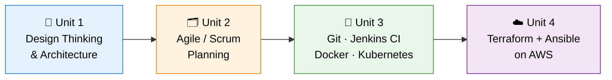

> **Why → What → How → Where:** Unit 1 defines *why* and *what* to build, Unit 2 plans *how* to deliver it, Unit 3 automates *build & packaging*, Unit 4 automates *where it runs* (infrastructure).

---

## 🗺️ Repository at a Glance

| Unit | Theme | Deliverable | Focus |
|:---:|---|---|---|
| **1** | Design Thinking & Product Planning | [📄 PDF](./Aditya_Soundale_2125UDSM1110_Devops_Unit1_MiniProject.pdf) | BRD, personas, FRS/NFRS, 3-tier architecture |
| **2** | Agile Product Planning & Scrum | [📄 PDF](./Aditya_Soundale_2125UDSM1110_Devops_Unit2_MiniProject.pdf) | Epics, user stories, backlog, sprints |
| **3** | DevOps Foundations, VCS, CI & Containers | [📄 PDF](./Aditya_Soundale_2125UDSM1110_DevOps_Unit3_MiniProject.pdf) | Lifecycle, Git, Jenkins, Docker, Kubernetes |
| **4** | Infrastructure as Code & Config Management | [📄 PDF](./Aditya_Soundale_2125UDSM1110_DevOps_Unit4_MiniProject.pdf) | Terraform, Ansible, AWS EC2, validation |

---

## 📂 File Structure

```text
DevOps-MiniProjects/
│
├── README.md                                                   ← You are here
│
├── Aditya_Soundale_2125UDSM1110_Devops_Unit1_MiniProject.pdf   ← Unit 1: Design Thinking & Product Planning
├── Aditya_Soundale_2125UDSM1110_Devops_Unit2_MiniProject.pdf   ← Unit 2: Agile / Scrum Planning
├── Aditya_Soundale_2125UDSM1110_DevOps_Unit3_MiniProject.pdf   ← Unit 3: DevOps Foundations, Git, Jenkins, Docker, K8s
└── Aditya_Soundale_2125UDSM1110_DevOps_Unit4_MiniProject.pdf   ← Unit 4: Terraform + Ansible on AWS
```

> 📌 The code referenced in Unit 4 (Terraform/Ansible) lives in a separate repository: [`academic-platform-iac-unit4`](https://github.com/adityasoundale/academic-platform-iac-unit4).

---

## 📐 Unit 1 – Design Thinking & Product Planning

**📅 Submitted:** August 19, 2026 &nbsp;|&nbsp; **📄 [Open PDF](./Aditya_Soundale_2125UDSM1110_Devops_Unit1_MiniProject.pdf)**

**Goal:** understand the academic domain deeply *before* writing code, and turn that understanding into a product vision, requirements and an architecture blueprint.

### 🔑 Key Topics
- Project charter & SDLC flow with four milestones (M1–M4)
- Business Requirements Document (BRD): five academic workflows and their manual bottlenecks
- Product vision, mission and **MVP vs. post-MVP** scope
- **5-Stage Design Thinking** (Empathize → Define → Ideate → Prototype → Test)
- **IBM Loop Engine** (Observe → Reflect → Make)
- Stakeholder responsibility matrix and 3 user personas
- Functional (FR-01 to FR-06) and Non-Functional (NFR-01 to NFR-04) requirements
- Multi-tier cloud-native architecture and a 7-phase DevOps roadmap
- Git initialisation and standard enterprise folder hierarchy

### 🧭 Design Thinking Process

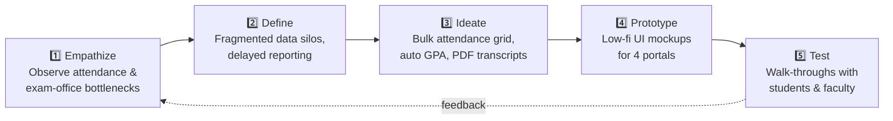

### 🔄 IBM Loop Engine

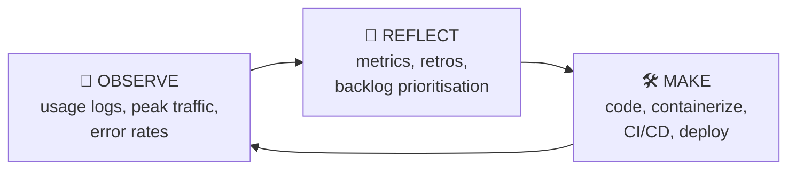

### 👥 Personas

| Persona | Role | Core Need |
|---|---|---|
| **Ananya Sharma** | CS Student | Real-time attendance % and instant marks |
| **Dr. Rajesh Kulkarni** | Associate Professor & HOD | Attendance in <2 min, error-free marks entry |
| **Suresh Patil** | Controller of Examinations | Grade moderation, locking and batch transcripts |

### 📋 Requirements Snapshot

| ID | Requirement |
|---|---|
| FR-01 | Authentication & Role-Based Access Control (JWT) |
| FR-02 | Student profile & enrolment management (PRN generation) |
| FR-03 | Course registration & credit engine |
| FR-04 | Session-based attendance with <75% flagging |
| FR-05 | Exam grading with automatic SGPA/CGPA |
| FR-06 | One-click PDF reports & transcripts |
| NFR-01 | Security: Bcrypt (cost ≥ 12), TLS 1.3, ORM-parameterised queries |
| NFR-02 | Performance: reads <300 ms, 1,000 concurrent users |
| NFR-03 | Availability: 99.9% uptime, self-healing Kubernetes |
| NFR-04 | Maintainability: >80% unit-test coverage, IaC |

### 🏗️ Target Architecture

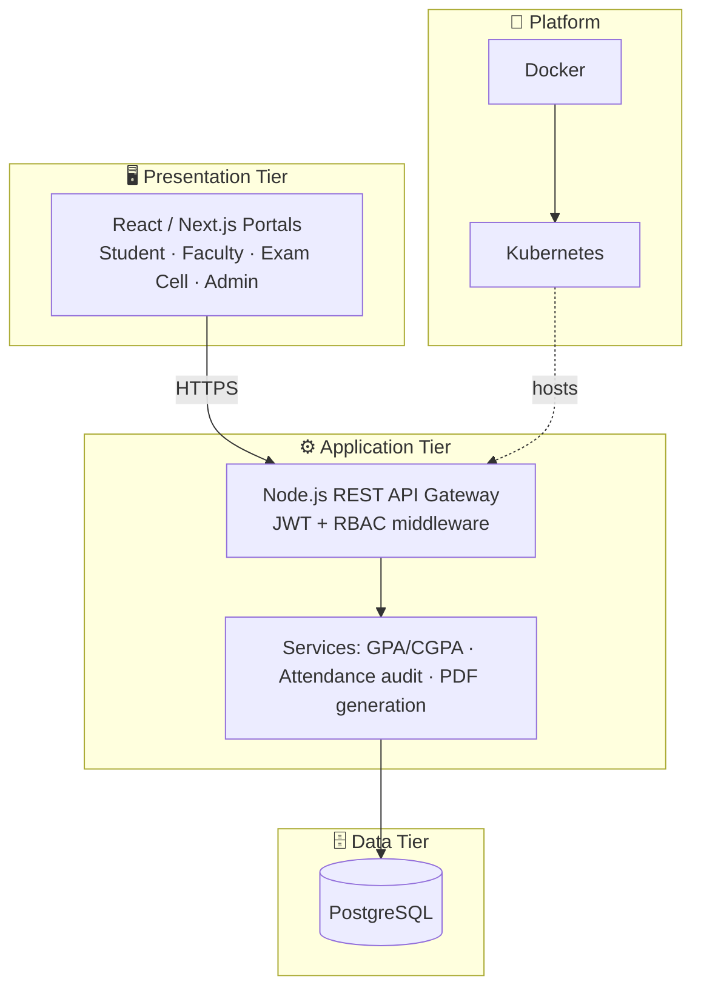

### 🗂️ Planned Project Layout (from Unit 1)

```text
student-record-platform/
├── .github/workflows/   # CI/CD pipelines
├── docs/                # BRD, FRS/NFRS, personas, API docs
├── src/
│   ├── config/          # DB pools, env config, secrets loaders
│   ├── controllers/     # Auth, Students, Courses, Attendance, Grades
│   ├── middlewares/     # Auth guards, RBAC, rate limiting, errors
│   ├── models/          # Schemas, ORM entities, migrations
│   └── services/        # GPA/CGPA, attendance audit, PDF generation
├── tests/               # Unit + integration tests
├── docker/  &  k8s/     # Dockerfile, compose, Kubernetes manifests
└── README.md
```

### 🛣️ 7-Phase DevOps Roadmap

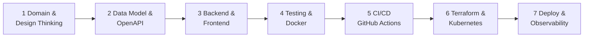

---

## 🗂️ Unit 2 – Agile Product Planning & Scrum Framework

**📅 Submitted:** September 04, 2026 &nbsp;|&nbsp; **📄 [Open PDF](./Aditya_Soundale_2125UDSM1110_Devops_Unit2_MiniProject.pdf)**

**Goal:** operationalise Unit 1's vision using Agile Scrum: roles, epics, user stories, a prioritised backlog and a sprint plan.

### 🔑 Key Topics
- Agile product vision and success benchmarks
- Scrum roles and artifacts (Product Owner, Scrum Master, Development Team)
- **7 high-level Epics**
- User stories with acceptance criteria / **Definition of Done (DoD)**
- **MoSCoW**-prioritised backlog with **Planning Poker** (Fibonacci) estimation
- **3-sprint cadence** with committed velocity
- Scrum board, sprint burndown chart and the four Scrum ceremonies
- Comparative study of 7 Agile frameworks

### 🔁 Scrum Lifecycle

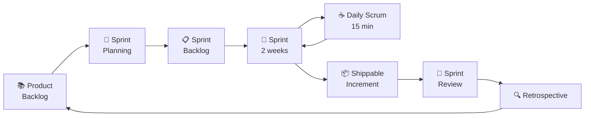

### 🧩 The 7 Epics

| Epic | Module | Scope |
|---|---|---|
| EPIC-01 | Student Management | Registration, PRN generation, search, updates, archival |
| EPIC-02 | Course Management | Catalog, credits, batches, enrolment lists |
| EPIC-03 | Attendance Management | Session marking, fast-grid, aggregate reports |
| EPIC-04 | Marks & Performance | CIA/end-sem entry, SGPA/CGPA engine |
| EPIC-05 | Authentication & Security | Login, sessions, JWT RBAC |
| EPIC-06 | Notifications & Alerting | <75% attendance alerts, hall-ticket and result broadcasts |
| EPIC-07 | Reporting & Analytics | Transcripts, department summaries, PDF export |

### 📊 Prioritised Backlog (MoSCoW + Planning Poker)

| ID | Epic | Story | Priority | Points |
|---|---|---|---|:---:|
| US-01 | Authentication | Login, JWT & RBAC middleware | Must | 5 |
| US-02 | Student Mgmt | Admission form & PRN allocation | Must | 3 |
| US-03 | Student Mgmt | Multi-criteria search & filtering | Must | 2 |
| US-04 | Student Mgmt | Profile update & document verification | Should | 3 |
| US-05 | Course Mgmt | Add course & credit ceiling | Must | 3 |
| US-06 | Course Mgmt | Registration & prerequisite checker | Must | 5 |
| US-07 | Attendance | Faculty marker with bulk toggle | Must | 5 |
| US-08 | Attendance | Student attendance dashboard | Should | 2 |
| US-09 | Marks & Grades | Marks entry & auto-grade calculation | Must | 5 |
| US-10 | Reporting | One-click PDF grade card | Must | 5 |

### 🗓️ Sprint Plan

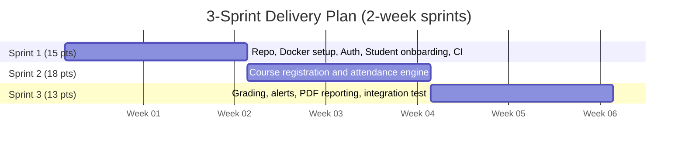

| Sprint | Goal | Velocity |
|---|---|:---:|
| **Sprint 1** (Wk 1–2) | Secure architecture, authentication, core student onboarding | 15 pts |
| **Sprint 2** (Wk 3–4) | Course registration and session-based attendance | 18 pts |
| **Sprint 3** (Wk 5–6) | Examination grading, alerts and verifiable PDF reporting | 13 pts |

### 🏛️ Agile Frameworks Compared

| Framework | Best fit in this project |
|---|---|
| **Scrum** ✅ | Chosen: small/medium cross-functional product team |
| Kanban | Operations tickets & maintenance |
| XP | High-risk grading-engine modules (TDD, pair programming) |
| Lean | MVP trimming & early discovery |
| LeSS / Scrum@Scale / SAFe | Future multi-department or multi-campus scaling |

---

## 🔁 Unit 3 – DevOps Foundations, Version Control, CI & Container Orchestration

**📄 [Open PDF](./Aditya_Soundale_2125UDSM1110_DevOps_Unit3_MiniProject.pdf)**

**Goal:** a theoretical and architectural study of the automated path from *commit → build → test → image → cluster*, based on the trainer's **Smart Library Management Platform** (Python/Flask, Jenkins, Docker, Kubernetes) and mapped onto the student's own platform.

### 🔑 Key Topics
- The "Wall of Confusion", environment drift and Integration Hell
- Traditional (Waterfall) vs. Agile vs. DevOps comparison
- The **8-phase DevOps lifecycle** and the shift-left testing paradigm
- Distributed version control with Git, **Git vs. GitHub**, enterprise branching strategy
- **Continuous Integration** with Jenkins (controller/agent model, 6-stage pipeline)
- **Docker**: namespaces, cgroups, image layering, VMs vs. containers
- **Kubernetes**: control-plane components, Pods, Deployments, Services, Minikube
- End-to-end integrated delivery path (commit → zero-downtime rollout)

### ♾️ The 8-Phase DevOps Lifecycle

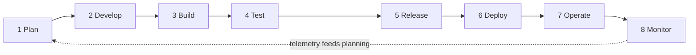

### 🌿 Branching Strategy

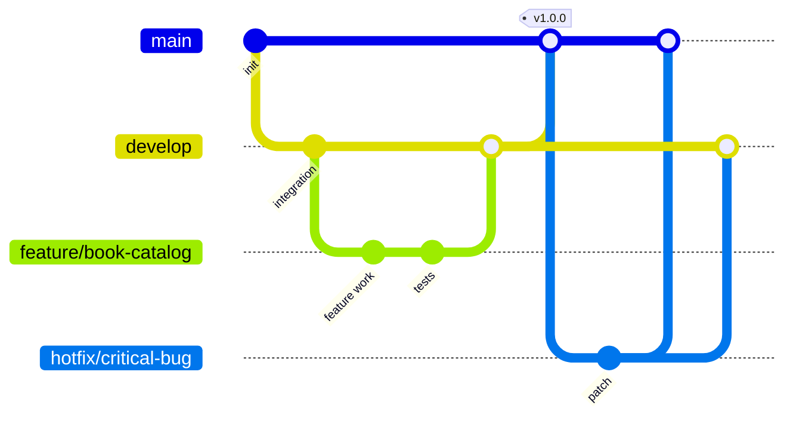

| Branch | Purpose |
|---|---|
| `main` | Protected, production-ready; merges only via approved Pull Requests |
| `develop` | Integration branch for tested features |
| `feature/*` | Short-lived branches for isolated feature work |
| `hotfix/*` | Emergency fixes cut from `main`, merged back to `main` and `develop` |

### 🧪 Jenkins CI Pipeline

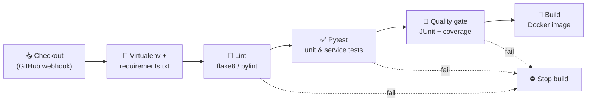

### 🐳 Virtual Machines vs. Containers

| Attribute | Virtual Machines | Docker Containers |
|---|---|---|
| Virtualization | Hardware level (hypervisor) | OS level (shared kernel) |
| Startup | Minutes | Milliseconds to seconds |
| Footprint | Gigabytes | Tens to hundreds of MB |
| Density | Tens per host | Hundreds per host |
| Portability | Hypervisor-specific | OCI-standard images |

### ☸️ Kubernetes Architecture

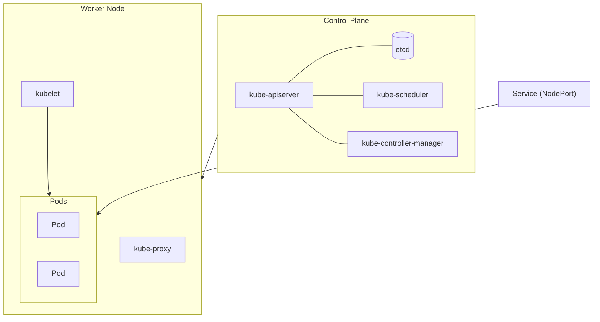

### 🚀 Commit-to-Cluster Flow

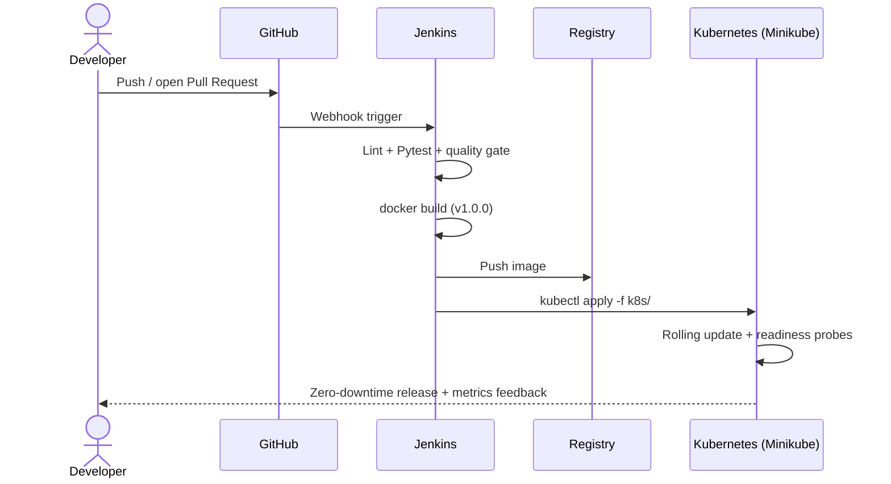

### 🔗 Trainer vs. Student Implementation

| Aspect | Trainer (Library Platform) | Student (Academic Platform) |
|---|---|---|
| Entities | Books, Borrowers, Loans, Fines | Students, Courses, Faculty, Marks |
| CI tests | `test_book_service.py`, `test_borrow_return.py` | `test_student_service.py`, `test_marks_mgmt.py` |
| Image | `library-platform:v1.0.0` | `student-platform:v1.0.0` |

---

## ☁️ Unit 4 – Infrastructure Automation (Terraform + Ansible on AWS)

**📄 [Open PDF](./Aditya_Soundale_2125UDSM1110_DevOps_Unit4_MiniProject.pdf)** &nbsp;|&nbsp; **💻 Code repo:** [`academic-platform-iac-unit4`](https://github.com/adityasoundale/academic-platform-iac-unit4)

**Goal:** replace manual "ClickOps" with a **declarative, idempotent** pipeline: Terraform provisions the AWS infrastructure, Ansible configures the server and deploys the containerised app.

### 🔑 Key Topics
- Infrastructure as Code with **Terraform** (VPC, subnet, IGW, route table, security group, EC2)
- **Remote state** in S3 with DynamoDB state locking
- Configuration management with **Ansible** (4 roles: `common`, `docker`, `nginx`, `student_app`)
- Dynamic **Terraform → Ansible handshake** (public IP injected into the inventory automatically)
- Nginx reverse proxy in front of the Flask API container
- **4-tier post-deployment validation**

### 🌩️ Cloud Topology

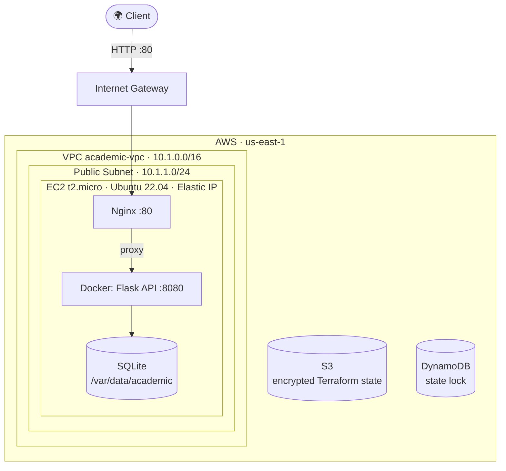

### 🧱 Infrastructure Mapping

| Component | Reference (Library) | Student Platform | AWS Primitive |
|---|---|---|---|
| Network | `10.0.0.0/16` | `10.1.0.0/16` (public `10.1.1.0/24`) | VPC, IGW, route table |
| Ingress | 22, 80, 5000 | 22, 80, 8080 | Security Group |
| Compute | t2.micro, Ubuntu 22.04 | t2.micro, 20 GB gp3 | EC2 |
| Database | SQLite book store | Persistent SQLite marks store | Docker host volume |
| Proxy | Nginx 80 → 5000 | Nginx 80 → 8080 | Templated Nginx config |
| Image | `library-platform:v1.0.0` | `student-records-app:v1.0.0` | Docker Engine CE |

### 🔄 Two-Tier Orchestration Handshake

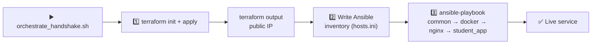

> The server IP is never hard-coded; it is read from Terraform's output and injected into the Ansible inventory at runtime.

### ✅ Four-Tier Validation Gates

| Gate | Target | Check |
|---|---|---|
| **1 · Network & OS** | SSH reachable | `nc -zvw 5 <ip> 22` |
| **2 · Daemons** | Docker and Nginx active | `systemctl is-active docker nginx` |
| **3 · App container** | Container up on 8080 | `docker ps --filter name=student-record-app` |
| **4 · API smoke tests** | Live REST endpoints | `curl -sf http://<ip>/api/health` |

**Endpoints exercised:** `GET /api/health` · `GET /api/students` · `POST /api/marks`

**Idempotency:** repeated playbook runs report `changed=0`, meaning the server is already in the desired state.

---

## 🧬 End-to-End Platform Architecture

How all four units fit together into one delivery pipeline:

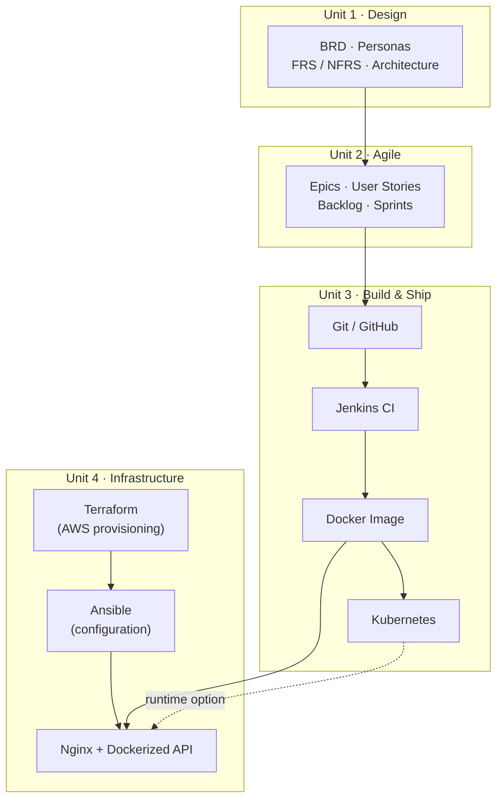

---

## 🛠️ Tech Stack Summary

| Layer | Technologies |
|---|---|
| **Methodology** | Agile Scrum + Kanban hybrid (Scrumban), IBM Design Thinking |
| **Planned application stack** | React/Next.js, Node.js REST API, PostgreSQL, JWT/RBAC |
| **Reference implementation** | Python, Flask, SQLite, Pytest |
| **Version control** | Git, GitHub (trunk + feature/hotfix branching) |
| **CI** | Jenkins (controller/agent), flake8, pylint, JUnit reports |
| **Containers** | Docker (OverlayFS layers), Kubernetes, Minikube |
| **IaC & CM** | Terraform (AWS provider, S3 + DynamoDB backend), Ansible roles |
| **Cloud** | AWS: VPC, EC2, Internet Gateway, Security Groups, S3, DynamoDB |
| **Web / proxy** | Nginx reverse proxy |
| **Observability (roadmap)** | Prometheus, Grafana |

---

## 🎯 Skills Demonstrated

- ✅ Translating a real-world domain into requirements, personas and an MVP
- ✅ Running Agile Scrum: epics, user stories, DoD, estimation, sprint planning, ceremonies
- ✅ Explaining and applying the full DevOps lifecycle and CI/CD concepts
- ✅ Git branching strategy and pull-request-driven workflows
- ✅ Containerisation fundamentals and Kubernetes orchestration concepts
- ✅ Infrastructure as Code with Terraform, including remote state and locking
- ✅ Idempotent configuration management with modular Ansible roles
- ✅ Post-deployment validation with layered health gates

---

## 🧭 How to Navigate This Repository

1. **New to the project?** Start with **Unit 1** for the problem and vision.
2. **Interested in process?** Read **Unit 2** for how the work is planned and estimated.
3. **Interested in pipelines?** Jump to **Unit 3** for CI/CD, Docker and Kubernetes.
4. **Interested in cloud automation?** Go to **Unit 4** for Terraform + Ansible on AWS.

Each unit is a self-contained PDF, so you can read them in any order.

---

<div align="center">

**Made with ☕ by [Aditya Soundale](https://github.com/adityasoundale)** · SY-AIDS · PRN 2125UDSM1110

⭐ If this repository helped you, consider giving it a star!

</div>
